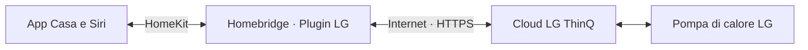
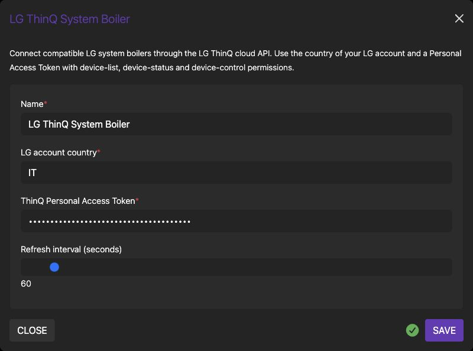

# Homebridge LG ThinQ System Boiler

**Il clima LG e l'acqua calda, nell'app Casa.**

Scegli caldo o freddo, regola le temperature e gestisci l'acqua sanitaria.<br>
Per pompe di calore aria-acqua compatibili, tramite il cloud LG ThinQ.

[](https://github.com/viames/homebridge-lg-thinq-system-boiler/releases/latest)
[](https://github.com/viames/homebridge-lg-thinq-system-boiler/actions/workflows/test.yml)
[](LICENSE)

[English](README.md) · **Italiano**

[Installazione](#installazione) · [Compatibilità](#compatibilità) · [Configurazione](#configurazione) · [Problemi comuni](#problemi-comuni)


---

## Clima e acqua sanitaria insieme in Casa

Collega una pompa di calore LG compatibile al tuo Homebridge. Il plugin espone **due servizi termostato per unità**: clima e acqua calda sanitaria. Puoi includerli nelle tue scene e automazioni di Casa.

| Clima | Acqua sanitaria | Temperature |
| :--- | :--- | :--- |
| Spento, caldo, freddo e automatico | Spento / riscaldamento abilitato | Valore corrente e desiderato |
| Temperatura obiettivo | Temperatura desiderata dell'acqua | Visualizzazione in Celsius |
| Segue la sorgente aria/acqua della macchina | Servizio termostato separato | Valori restituiti da ThinQ |

La temperatura del clima può essere quella **dell'acqua del circuito**, non necessariamente dell'aria ambiente. Dipende dalla sorgente di controllo della macchina.



**È un'integrazione cloud.** Servono internet sul dispositivo Homebridge e sulla pompa di calore, disponibilità del servizio LG e un token personale. Il plugin non comunica direttamente con l'indirizzo Wi-Fi locale della macchina.

## Compatibilità

| Componente | Evidenza |
| --- | --- |
| **LG THERMA V, unità esterna HU091.U43** | Validazione fisica registrata dal progetto: clima, sanitario, modalità e temperature |
| **Profilo ThinQ AWHP_019101_WW** | Profilo dell'impianto verificato |
| Raspberry Pi 3 con Raspberry Pi OS a 32 bit | Host della validazione fisica registrata |
| Node.js 22, 24 e 26 | Lint, build, test e controllo pacchetto in [GitHub Actions](https://github.com/viames/homebridge-lg-thinq-system-boiler/actions/workflows/test.yml) |
| Homebridge 1.8+ e 2.x | Compatibilità dichiarata; non equivale a prove fisiche su ogni versione |
| Altre unità `DEVICE_SYSTEM_BOILER` | Rilevate per tipo; la mappatura di stato e comandi va verificata |
| Normali condizionatori ThinQ e altri tipi di dispositivo | Fuori dall'ambito del plugin |

La macchina deve essere già online nell'app ThinQ e restituita dall'API come **`DEVICE_SYSTEM_BOILER`**. Il nome THERMA V o il solo Wi-Fi non garantiscono la compatibilità. Il rilevamento non usa una lista rigida di modelli, ma la mappatura attuale prevede specifici campi ThinQ.

## Installazione

### 1. Verifica account e token

Controlla che la pompa di calore funzioni nell'app LG ThinQ. Annota il **paese dell'account LG**, che può differire dal luogo in cui si trova Homebridge.

Apri il [portale PAT di LG](https://connect-pat.lgthinq.com) con lo stesso account e crea un Personal Access Token, ad esempio chiamato `Homebridge LG System Boiler`. Abilita i permessi per elenco dispositivi, lettura dello stato e controllo. Inserisci il token solo nella configurazione locale del plugin; non è la password dell'account LG.

Il token è una credenziale. Conserva riservati anche configurazione Homebridge e backup. Se viene esposto o non serve più, revocalo dal portale LG. Il plugin non genera o rinnova automaticamente i token. [Guida LG](https://github.com/thinq-connect/jsthinqconnect#obtaining-and-using-a-personal-access-token).

### 2. Installa l'archivio compilato

Prima esegui un backup di configurazione e associazioni Homebridge. Conserva separatamente anche l'archivio del plugin: i pacchetti GitHub possono non essere inclusi nei backup.

La guida installa l'**archivio GitHub 0.1.3**, con questa documentazione e il modulo aggiornato. Il plugin è anche [pubblicato su npm](https://www.npmjs.com/package/homebridge-lg-thinq-system-boiler): la versione 0.1.3 aggiunge il supporto a Node.js 26 e gestisce gli errori di lettura in background senza modificare i comandi della pompa.

Nell'immagine ufficiale Raspberry Pi, dal terminale Homebridge:

```sh
cd /var/lib/homebridge
npm install --omit=dev --ignore-scripts https://github.com/viames/homebridge-lg-thinq-system-boiler/releases/download/v0.1.3/homebridge-lg-thinq-system-boiler-0.1.3.tgz
```

Usa l'account proprietario della cartella. Via SSH potrebbe essere necessario passare all'utente del servizio. Per un'installazione npm globale già esistente, usa `npm install -g --omit=dev --ignore-scripts` con lo stesso URL e la convenzione di privilegi del tuo impianto.

Su Docker/NAS usa la procedura del tuo installer e la cartella dei plugin realmente caricata da Homebridge, con persistenza dopo la ricreazione del container. Non installare una seconda copia di Homebridge per correggere un errore di permessi.

Per scegliere invece npm, usa `npm install homebridge-lg-thinq-system-boiler@0.1.3` nella cartella dei plugin esistente (`-g` per un impianto globale). L'indicizzazione nella ricerca può richiedere tempo.

La [release](https://github.com/viames/homebridge-lg-thinq-system-boiler/releases/latest) contiene JavaScript compilato e `SHA256SUMS`. Dopo aver scaricato entrambi, verifica con `shasum -a 256 -c SHA256SUMS` su macOS o `sha256sum -c SHA256SUMS` su Linux. Non serve compilare TypeScript sul Raspberry.

### 3. Configura e riavvia

In Homebridge UI 5.29: **Plugins → LG ThinQ System Boiler → Plugin Actions → Plugin Config**. Altre versioni possono usare la voce **Impostazioni/Settings**.



*Istanza separata per la documentazione, con dati dimostrativi. Non usa account reali e non collega una pompa di calore.*

Inserisci paese dell'account e token, salva e riavvia Homebridge. Il log deve indicare `Configured … LG ThinQ system boiler(s).`. Il numero varia in base alle unità compatibili dell'account; zero significa che non sono state trovate unità del tipo previsto.

### 4. Apri Casa

Un bridge già associato aggiunge l'accessorio attraverso quell'associazione. Nuovi bridge o child bridge richiedono il proprio abbinamento iniziale. Cerca entrambi i servizi, clima e sanitario: possono essere raggruppati nello stesso accessorio. Usa **Mostra come riquadri separati**, se disponibile.

Scegli nomi e stanze nell'app Casa. Il nome iniziale deriva dall'alias ThinQ; il plugin non presume una stanza di installazione.

## Configurazione

In alternativa al modulo, aggiungi questo oggetto all'array `platforms` esistente:

```json
{
  "platform": "LGThinQSystemBoiler",
  "name": "LG ThinQ System Boiler",
  "country": "IT",
  "accessToken": "YOUR_THINQ_PAT",
  "refreshInterval": 60
}
```

Sostituisci il segnaposto del token localmente e `IT` se il paese del tuo account è diverso. Conserva bridge e altri plugin.

| Campo | Funzione |
| --- | --- |
| `platform` | Alias obbligatorio `LGThinQSystemBoiler` |
| `name` | Etichetta della piattaforma/log, non alias del singolo dispositivo |
| `country` | Paese dell'account LG a due lettere; default `IT`, normalizzato in maiuscolo |
| `accessToken` | Personal Access Token; senza token il rilevamento è disabilitato |
| `refreshInterval` | Polling in background, default 60 secondi, limitato a 30–600 |

Non servono IP locale, stanza o ID dispositivo. All'avvio vengono considerate tutte le unità dell'account di tipo `DEVICE_SYSTEM_BOILER`; non è disponibile un filtro per singolo dispositivo. Il supporto al rilevamento multiplo è implementato, ma la validazione fisica documentata riguarda un impianto.

L'intervallo non è un tetto alle richieste: letture di Casa e comandi possono provocare aggiornamenti aggiuntivi. Non è un'integrazione con eventi push. Dopo modifiche a token/paese o aggiunta di una macchina, riavvia Homebridge per ripetere il rilevamento.

## Comandi e significato delle temperature

Il clima offre Off, Heat, Cool e Auto. Spento invia `POWER_OFF`; le altre modalità selezionano il funzionamento e poi inviano `POWER_ON`.

La temperatura corrente e quella desiderata provengono dalla voce Celsius di `roomTemperatureInUnits`. Se `roomTempMode` è `WATER`, il setpoint riguarda **l'acqua del circuito**; negli altri casi sono usati i campi aria. In raffrescamento viene usato il target freddo; in caldo e automatico, quello caldo.

L'interfaccia clima espone 5–57 °C a passi di 1 °C. Il sanitario espone Off/Heat e 30–80 °C a passi di 1 °C, leggendo `hotWaterTemperatureInUnits` e comandando `hotWaterMode`. **Questi sono limiti dell'interfaccia, non temperature consigliate**: la macchina e LG possono applicare vincoli più stretti o rifiutare un comando.

Lo stato caldo/freddo deriva da alimentazione e modalità selezionata. Nel sanitario deriva dall'abilitazione. Non è una misura del funzionamento istantaneo del compressore né dei consumi.

Non sono esposti programmi LG, consumi e storico, gestione multizona, curve e funzioni installatore, umidità, telemetria compressore o controllo locale offline. Per queste funzioni usa il controller/app LG. La mappatura non copre automaticamente ogni schema di un modello diverso.

## Problemi comuni

| Problema | Verifica |
| --- | --- |
| Plugin assente dalla ricerca | Controlla l'indicizzazione npm o usa l'archivio GitHub |
| Token assente o autenticazione fallita | PAT, permessi, account e paese; salva e riavvia |
| Zero unità trovate | Tipo API `DEVICE_SYSTEM_BOILER`, macchina online e account corretto |
| Un termostato sembra mancante | Controlla i servizi raggruppati nell'accessorio |
| Temperatura inattesa | Sorgente aria/acqua e campi effettivamente restituiti |
| Comando rifiutato | Stato della macchina, modalità e intervallo consentito da LG |

Il rilevamento avviene all'avvio. Dopo aver corretto un errore iniziale, riavvia Homebridge: non è programmato un nuovo tentativo automatico di discovery. Per errori successivi controlla internet, DNS, token, servizio LG e disponibilità della macchina. Non presumere lo stesso comportamento di riconnessione del plugin Prana Local.

Valori zero o fissi possono indicare campi mancanti: questa implementazione usa fallback numerici quando lo schema non corrisponde. Valuta la compatibilità prima di fidarti delle letture di un altro modello.

## Diagnostica in sola lettura

Lo strumento è disponibile dal **repository sorgente**, non dall'archivio runtime installato:

```sh
git clone https://github.com/viames/homebridge-lg-thinq-system-boiler.git
cd homebridge-lg-thinq-system-boiler
npm ci --ignore-scripts
npm run inspect-device
```

Per un paese diverso dal default italiano, ad esempio: `THINQ_COUNTRY=GB npm run inspect-device`.

Il token viene richiesto senza mostrarlo nel terminale. Lo script legge elenco, profilo e stato; non invia comandi di controllo. Il file è `diagnostics/thinq-system-boiler-profile.json`, con permessi riservati e ignorato da Git.

Vengono rimosse ricorsivamente chiavi legate a identificativi e credenziali. **Rivedi comunque il file prima di condividerlo**: il filtro automatico di chiavi note non garantisce l'anonimato di ogni campo di un fornitore. Non scrivere token direttamente nei comandi o nella cronologia della shell.

## Aggiornamento, rimozione e riservatezza

Per aggiornare, fai un backup, leggi le note della versione e usa lo stesso metodo e la stessa cartella. Le distribuzioni GitHub e npm possono avere versioni diverse: verifica quale stai installando. Riavvia e verifica entrambi i servizi. Per tornare indietro usa un archivio compilato precedente, se presente: le release meno recenti possono avere solo sorgenti da compilare. Non cancellare il bridge da Casa come passo di aggiornamento.

Per rimuovere il plugin, elimina la piattaforma dalla configurazione, disinstalla con il gestore o `npm uninstall homebridge-lg-thinq-system-boiler` nella cartella originale (`-g` per installazioni globali) e riavvia. Se resta un accessorio in cache, rimuovi solo quello LG. Revoca il PAT se non serve più ad alcun client.

Homebridge conserva il token nella configurazione locale. Il campo mascherato non equivale a cifratura; proteggi file e backup. Il runtime invia il token all'endpoint HTTPS LG selezionato. Metadati locali dell'accessorio includono ID, alias e modello. Il plugin non ha un servizio di analytics.

[Segnala un problema o un modello provato](https://github.com/viames/homebridge-lg-thinq-system-boiler/issues/new/choose) con modello, profilo/tipo API se noto, versioni, sistema e breve errore ripulito. Non pubblicare token, password, seriali, ID dispositivo, email personali, identificativi della rete o configurazioni complete.

---

Software indipendente di [viames](https://github.com/viames), con [licenza MIT](LICENSE). Non affiliato a LG o Apple e non verificato dal progetto Homebridge. [Guide tecniche](docs/configuration.md) · [Contribuire](CONTRIBUTING.md) · [Homebridge Prana Local](https://github.com/viames/homebridge-prana-local).
