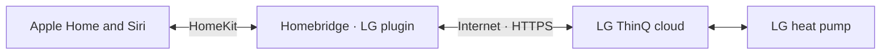
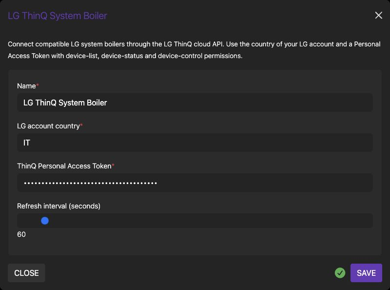

# Homebridge LG ThinQ System Boiler

**LG heating and hot water, in Apple Home.**

Choose heating or cooling, adjust target temperatures and control domestic hot water. 
For compatible LG ThinQ air-to-water heat pumps, through LG's cloud API.

**English** · [Italiano](README.it.md)

[Get started](#get-started) · [Compatibility](#compatibility) · [Settings](docs/configuration.md) · [Help](docs/troubleshooting.md)

---

## Heating and hot water, together in Home

Connect a compatible LG system boiler to the Homebridge you already use. The plugin adds **two thermostat services per unit**: space climate and domestic hot water. Include their controls in your own Apple Home scenes and automations.

| Space climate | Domestic hot water | Temperature readings |
| :--- | :--- | :--- |
| Off, Heat, Cool and Auto | Off / heating enabled | Current and target values |
| Target temperature | Hot-water target temperature | Celsius display |
| Uses the unit's air/water control source | Separate thermostat service | Values reported by ThinQ |

The climate reading may be **circuit water temperature**, depending on the unit's control source. It is not necessarily room-air temperature. [Exact behavior and limits →](docs/configuration.md#controls-and-temperature-meaning)

**This is a cloud integration.** Homebridge, the LG service and the heat pump need internet access. It uses the official ThinQ Connect API and a Personal Access Token; it does not provide direct local Wi-Fi control.

## Compatibility

| Component | Evidence |
| :--- | :--- |
| **LG THERMA V · outdoor unit HU091.U43** | Recorded project hardware validation: climate, hot water, modes and temperatures |
| **ThinQ profile AWHP_019101_WW** | Profile of the validated installation |
| Raspberry Pi 3 with 32-bit Raspberry Pi OS | Host used for the recorded hardware validation |
| Node.js 22 / 24 / 26 | Lint, build, tests and package checks in [GitHub Actions](https://github.com/viames/homebridge-lg-thinq-system-boiler/actions/workflows/test.yml) |
| Homebridge 1.8+ / 2.x | Declared package compatibility; not a claim of hardware testing on every version |
| Other ThinQ `DEVICE_SYSTEM_BOILER` units | Discovered by device type; their state/control mapping still needs verification |
| Ordinary ThinQ air conditioners and other device types | Outside this plugin's scope |

The heat pump must already work in the LG ThinQ app and be returned by the API as **`DEVICE_SYSTEM_BOILER`**. A THERMA V label or Wi-Fi support alone does not guarantee compatibility. Discovery is not tied to one model name, but the current implementation maps a specific set of ThinQ state/control fields.

## Get started

### 1. Confirm the ThinQ account

Check that your heat pump is online in the LG ThinQ app. Note the **country of that LG account**: the plugin uses it to choose the regional API endpoint. No device IP or room name is required.

### 2. Create a Personal Access Token

Use [LG's Personal Access Token portal](https://connect-pat.lgthinq.com) with the same account. Enable device-list, device-status and device-control permissions. Enter the token only in your local Homebridge configuration. [Token setup and permissions →](docs/installation.md#personal-access-token)

### 3. Install and configure

[**Download the compiled release**](https://github.com/viames/homebridge-lg-thinq-system-boiler/releases/latest) and follow the [installation guide](docs/installation.md). The guide below installs the **GitHub 0.1.3 archive**, including these guides and updated settings help. The plugin is also [published on npm](https://www.npmjs.com/package/homebridge-lg-thinq-system-boiler); version 0.1.3 adds Node.js 26 support and handles background polling failures without changing control commands.

Open **Plugin Actions → Plugin Config** (or **Settings**, depending on UI version). Enter your account country, token and desired polling interval.

*Real Homebridge UI in a separate documentation instance. The masked value is a dummy example; no real account or heat-pump connection is used.*

Prefer JSON? Start with the [minimal configuration](docs/configuration.md#minimal-configuration).

### 4. Restart and open Apple Home

Restart Homebridge and look for `Configured … LG ThinQ system boiler(s).` in its log. An already paired bridge adds the accessory through that bridge. New bridges and child bridges need their own one-time pairing.

Look for both thermostat services. Home may group them; inspect the accessory settings or use **Show as Separate Tiles**, if available. Choose names and rooms in Apple Home. Device aliases are initially taken from ThinQ, not from an assumed installation room.

## Read before adjusting temperatures

- **Air and water control differ.** The plugin follows the unit's `roomTempMode`; a climate setpoint can be a water-circuit setpoint.
- **HomeKit's displayed ranges are interface limits.** The unit and ThinQ can impose narrower limits or reject unavailable modes. They are not recommended operating temperatures.
- **Status is derived from reported mode/enabled flags.** The thermostat's heating indication is not proof that the compressor is running at that instant.
- **The background interval defaults to 60 seconds.** Home reads and commands can trigger additional API requests; this is not a push integration.
- Schedules, energy statistics, multi-zone control and installer functions are not exposed by this release.

[Control mapping and limitations →](docs/configuration.md#controls-and-temperature-meaning)

## Guides and support

| I want to… | Open |
| :--- | :--- |
| Install, configure a token, update or remove | [Installation guide](docs/installation.md) |
| Understand settings, temperatures and controls | [Configuration reference](docs/configuration.md) |
| Fix discovery, authentication or missing services | [Troubleshooting and FAQ](docs/troubleshooting.md) |
| Read the complete Italian guide | [Documentazione italiana](README.it.md) |
| Report a bug or another model | [Issue forms](https://github.com/viames/homebridge-lg-thinq-system-boiler/issues/new/choose) |
| Inspect compatibility without sending commands | [Read-only diagnostics](docs/troubleshooting.md#read-only-device-inspection) |
| Contribute code | [Contributing](CONTRIBUTING.md) |

The token grants access to the permissions selected at LG. Homebridge stores it in its local configuration; protect that file and its backups. The UI masks the input, but masking is not encryption. [Token and diagnostic privacy →](docs/troubleshooting.md#token-and-diagnostic-privacy)

---

Independent community software by [viames](https://github.com/viames), under the [MIT license](LICENSE). Not affiliated with LG or Apple and not verified by Homebridge. Product names belong to their respective owners.

Uses LG ThinQ Connect API conventions described in [LG's SDK documentation](https://github.com/thinq-connect/jsthinqconnect). Also by viames: [Homebridge Prana Local](https://github.com/viames/homebridge-prana-local), for local PRANA ventilation control.
